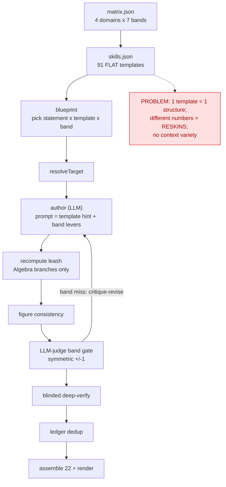
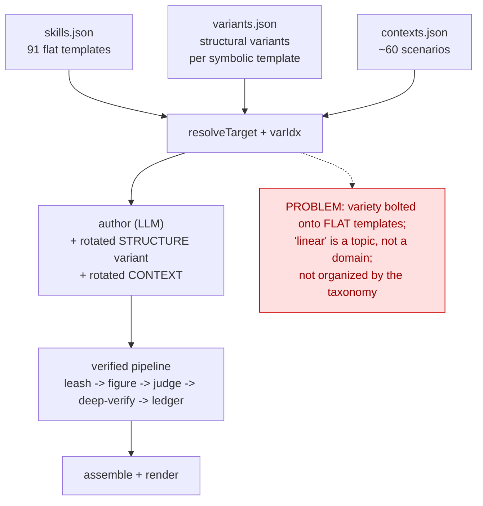
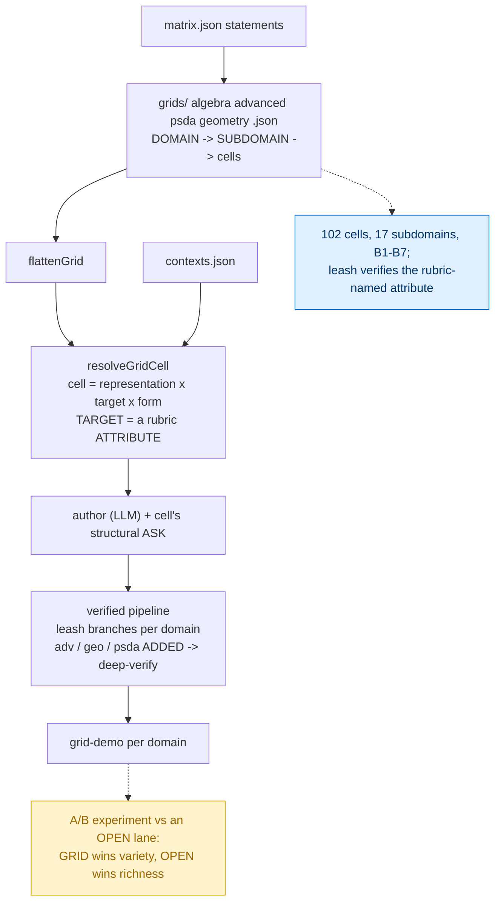
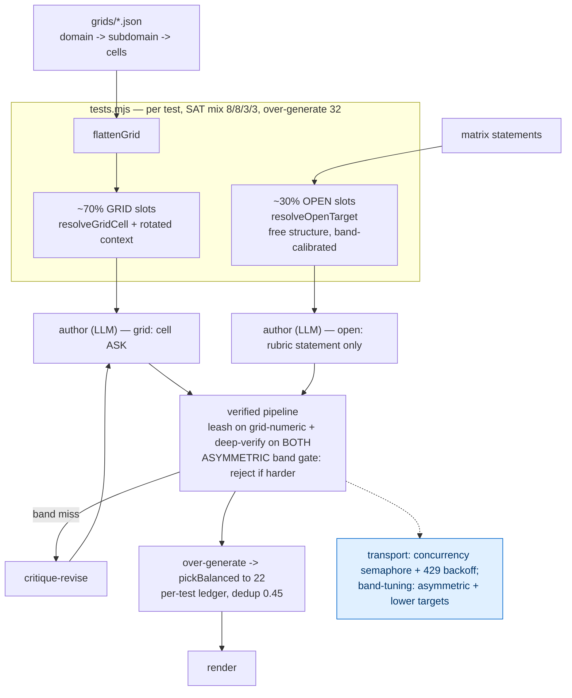
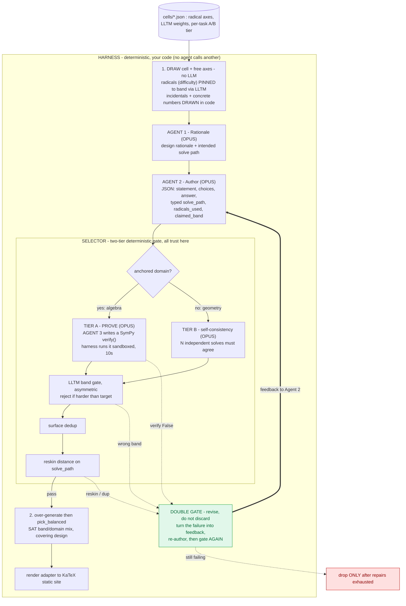

# SAT-Insight-Gen — architecture evolution

Four stages this session. The **verified pipeline** (author → recompute leash → figure-consistency → LLM-judge band gate → blinded deep-verify → ledger) is constant; what changed each time is **where items come from** and **how variety is produced**. Each stage's problem drove the next.

---

## 1 — Flat templates (starting point)

*Procedural figure generators (graphgen/diagramgen) were disabled in parallel. The reskin problem drove stage 2.*

---

## 2 — Flat templates + variant/context injection

*Variety improved but was a patch. "Organize by domain then subdomain" drove stage 3.*

---

## 3 — Variety GRID (domain → subdomain → cells)

*The grid won variety but had a canonical floor; open generation was richer but clustered. That drove the hybrid.*

---

## 4 — HYBRID: grid + open lane (current)

*Grid = variety + verified backbone; open lane = richness ceiling. Band gate pinned to exact-low; transport hardened against rate limits.*

---

## 5 — BUILD_SPEC: four-agent linear pipeline (current)

A clean redesign from `BUILD_SPEC.md` (PromptCoT concept→rationale→problem + PROVE program-as-verifier). The producer is **linear** — no agent mesh, no recursive tuning — ending in a **deterministic two-tier selector**. It targets the session's three recurring pains head-on: reskins (rationale agent + radical/incidental split), difficulty drift (deterministic LLTM over *known* radicals, not an LLM-judge guessing from text), and trust (PROVE recomputes every answer).

**What changed from #4 → #5, and why:**
- **Variety is harness-drawn, not model-coaxed.** Radicals (difficulty-determining: steps, both-sides, distribution, fractions, answer-type) are *pinned* to the band; incidentals (context, variable, numbers, format) are *drawn in code*. Asking the model to "be creative" re-collapses to canonical — so we don't. (Replaces the grid `form` + open-lane "be inventive".)
- **Difficulty is deterministic again — but soundly.** The LLTM is additive over radicals the harness *set* (ground truth), so it sidesteps the brittleness that killed the earlier text-inferred estimator, and it removes the LLM-judge's +1 drift entirely. (Replaces the LLM-judge band gate.)
- **PROVE generalizes the leash.** Agent 3 writes a fresh sympy `verify()` per item, executed sandboxed — no hand-written recompute branch per skill. (Generalizes `recompute.js`.)
- **Rationale-first (PromptCoT).** Writing the design rationale before the problem is the structural lever against reskins.
- **One direction, deterministic gate.** Linearity is what makes it shippable; tuning knobs (over-generate ×, ε reskin floor, band tolerance, consistency N) sit on top of a frozen selector.
- **Double gate, not discard — all on Opus.** A rejected item isn't thrown away: the failure is turned into a concrete revision instruction, the author (Agent 2) re-writes it, and it runs the gate **again**; it's dropped only after the repair budget is exhausted. All four agents (rationale, author, PROVE checker-writer, consistency solver) run on Claude Opus.

*Build order: ship `linear_equations_one_variable` end-to-end first (steps 1–4 are the product); LLTM weight-refit + the structure-vs-model correlation are optional research (step 5) that rides on top.*
