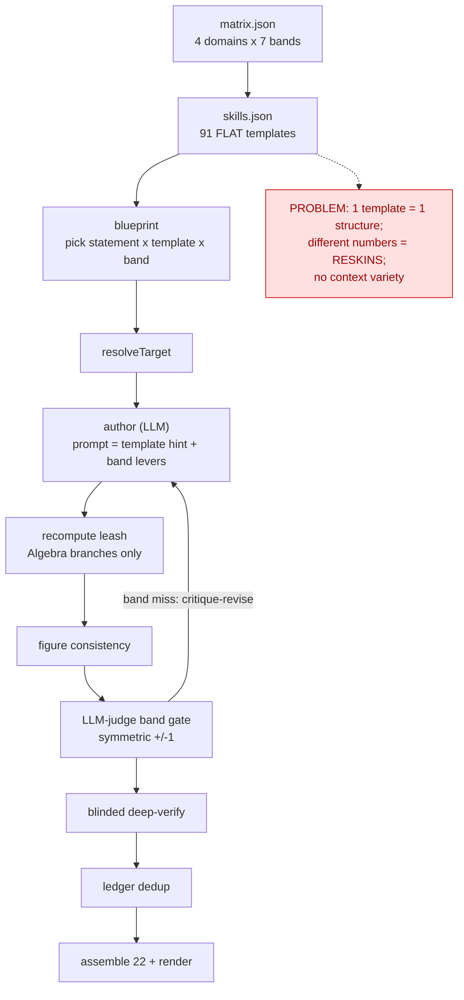
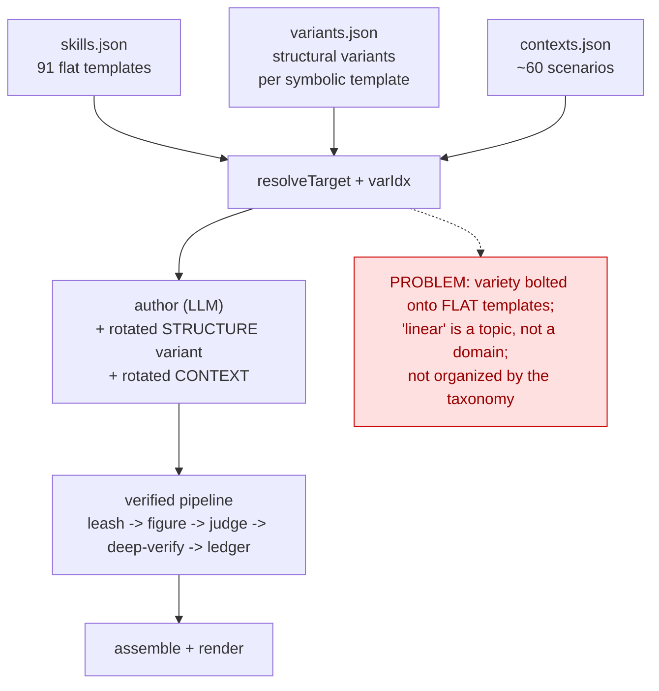
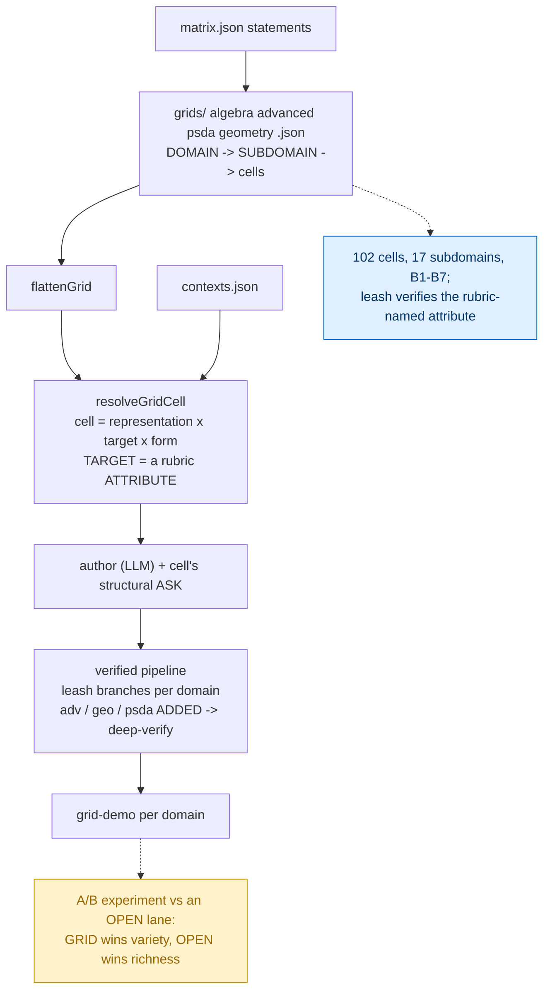
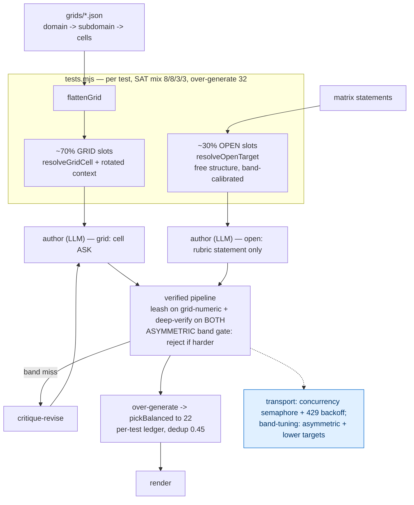

# SAT-Insight-Gen — architecture evolution

Four stages this session. The **verified pipeline** (author → recompute leash → figure-consistency → LLM-judge band gate → blinded deep-verify → ledger) is constant; what changed each time is **where items come from** and **how variety is produced**. Each stage's problem drove the next.

---

## 1 — Flat templates (starting point)

*Procedural figure generators (graphgen/diagramgen) were disabled in parallel. The reskin problem drove stage 2.*

---

## 2 — Flat templates + variant/context injection

*Variety improved but was a patch. "Organize by domain then subdomain" drove stage 3.*

---

## 3 — Variety GRID (domain → subdomain → cells)

*The grid won variety but had a canonical floor; open generation was richer but clustered. That drove the hybrid.*

---

## 4 — HYBRID: grid + open lane (current)

*Grid = variety + verified backbone; open lane = richness ceiling. Band gate pinned to exact-low; transport hardened against rate limits.*
